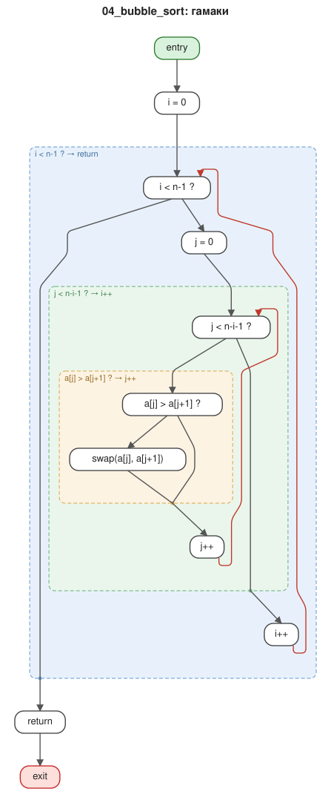
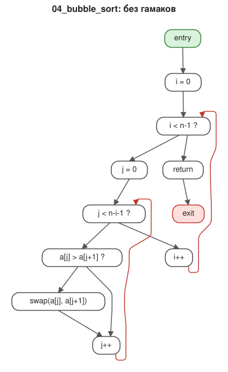
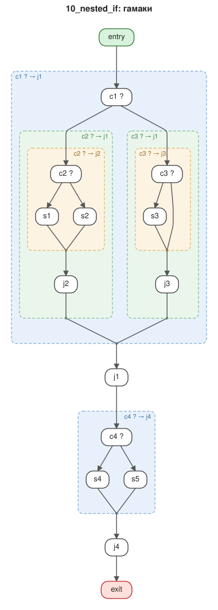
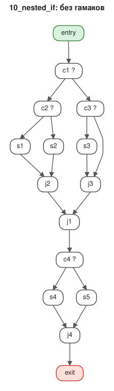
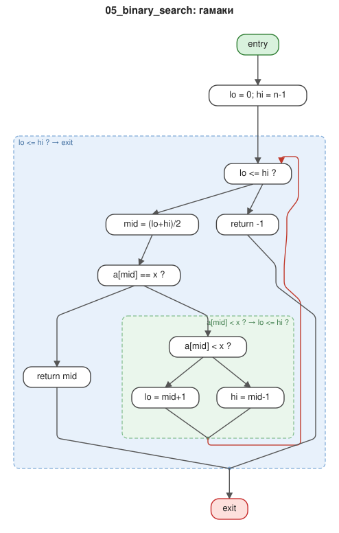
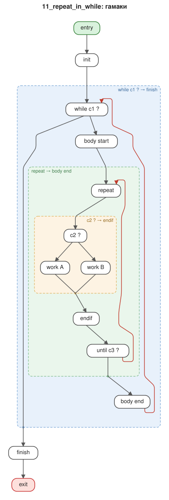

# Примеры визуализации

Каждый граф `*.graphml` нарисован утилитой `hammock_layout` в двух вариантах:

* `svg/<имя>.svg` — укладка на основе гамаков: гамаки уложены от меньших к большим
  и показаны вложенными рамками; в рамку дуги входят только в начальную вершину
  (сверху), а выходят одной дугой из порта на нижней границе (точка) в конечную вершину;
* `svg/<имя>_flat.svg` — обычная укладка Сугиямы того же графа для сравнения.

Обратные дуги (циклы) нарисованы красным и огибают вершины сбоку.

Перерисовать все примеры:

```bash
cmake --build build --target examples
```

| Пример | Что показывает | Гамаки | Без гамаков |
|---|---|---|---|
| `01_if_then_else` | ветвление — один гамак | [svg](svg/01_if_then_else.svg) | [svg](svg/01_if_then_else_flat.svg) |
| `02_while_loop` | цикл while — гамак «заголовок → выход из цикла» | [svg](svg/02_while_loop.svg) | [svg](svg/02_while_loop_flat.svg) |
| `03_euclid_gcd` | ветвление внутри цикла (алгоритм Евклида) | [svg](svg/03_euclid_gcd.svg) | [svg](svg/03_euclid_gcd_flat.svg) |
| `04_bubble_sort` | три уровня вложенности: if в цикле в цикле | [svg](svg/04_bubble_sort.svg) | [svg](svg/04_bubble_sort_flat.svg) |
| `05_binary_search` | досрочный `return` из цикла: гамак кончается в выходе | [svg](svg/05_binary_search.svg) | [svg](svg/05_binary_search_flat.svg) |
| `06_switch` | многовариантное ветвление | [svg](svg/06_switch.svg) | [svg](svg/06_switch_flat.svg) |
| `07_loop_with_break` | цикл с `break`: тело цикла — не гамак, выделен цикл целиком | [svg](svg/07_loop_with_break.svg) | [svg](svg/07_loop_with_break_flat.svg) |
| `08_irreducible` | неприводимый цикл с двумя входами | [svg](svg/08_irreducible.svg) | [svg](svg/08_irreducible_flat.svg) |
| `09_sequence` | линейный участок: только пересекающиеся гамаки, рамок нет | [svg](svg/09_sequence.svg) | [svg](svg/09_sequence_flat.svg) |
| `10_nested_if` | вложенные ветвления и два if подряд | [svg](svg/10_nested_if.svg) | [svg](svg/10_nested_if_flat.svg) |
| `11_repeat_in_while` | repeat-until внутри while, if внутри repeat | [svg](svg/11_repeat_in_while.svg) | [svg](svg/11_repeat_in_while_flat.svg) |
| `12_random_structured` | случайная структурированная программа: 53 вершины, 23 гамака | [svg](svg/12_random_structured.svg) | [svg](svg/12_random_structured_flat.svg) |

## Галерея

### Сортировка пузырьком

 

### Вложенные ветвления

 

### Двоичный поиск



### repeat внутри while


